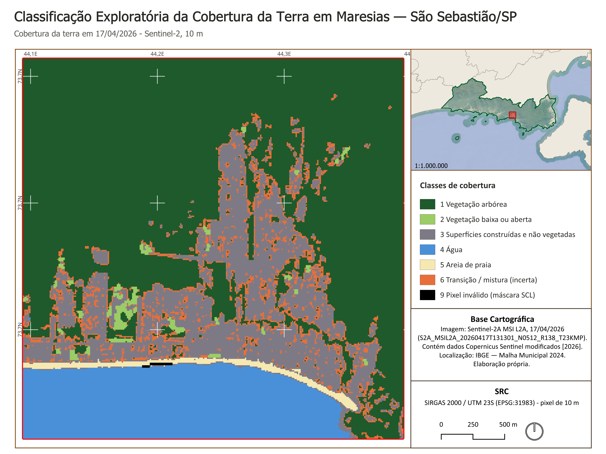

# Classificação da Cobertura da Terra em Maresias — São Sebastião/SP

**[English version](README.md)** · **Página no portfólio:** https://gabrielloubarboza.github.io/projetos/maresias/

Classificação exploratória de uma cena Sentinel-2 com QGIS, índices espectrais e regras explícitas,
num recorte de 9 km² de Maresias, no litoral norte de São Paulo (bioma Mata Atlântica).

Autor: **Gabriel Barboza Lourenço** · QGIS 3.40 LTR / PyQGIS · GDAL · Sentinel-2 L2A · 2026

<p align="center"></p>

> **Classificação exploratória.** O mapa mostra a cobertura observável numa única data
> (17/04/2026), obtida por regras espectrais e de contexto. Não é um mapeamento oficial de uso do
> solo, não foi validado em campo, não tem avaliação independente de acurácia e não identifica
> vegetação nativa.

**Relatório final (PDF, 5 páginas A4 paisagem):**
[`resultados/relatorio_classificacao_cobertura_maresias.pdf`](resultados/relatorio_classificacao_cobertura_maresias.pdf)

## 1. Pergunta e objetivo

> Em que medida uma imagem de satélite Sentinel-2 permite identificar e distinguir diferentes tipos
> de cobertura da terra em Maresias, e quais áreas apresentam maior incerteza na classificação?

O objetivo é verificar quais padrões básicos — floresta, ocupação, praia e água — uma única cena
separa com segurança, usando bandas espectrais, índices e regras explícitas no QGIS, e documentar
onde a separação deixa de ser confiável. O estudo não é uma classificação de biomas: a Mata
Atlântica é o contexto ambiental do recorte.

## 2. Área de estudo

- **Local:** Maresias, São Sebastião/SP. O recorte reúne a encosta florestada da Serra do Mar, a
  planície costeira ocupada, a praia e o mar.
- **Recorte:** quadrado de 3 × 3 km (9,00 km²) em SIRGAS 2000 / UTM 23S (EPSG:31983), centro em
  45,5650° O / 23,7834° S. Polígono em `dados/area_estudo/area_estudo_maresias.gpkg`.
- **Contexto:** bioma Mata Atlântica (IBGE, 2025).

## 3. Imagem Sentinel-2

| Item | Valor |
|---|---|
| Produto | Copernicus Sentinel-2A MSI, Level-2A (reflectância de superfície) |
| Cena | `S2A_MSIL2A_20260417T131301_N0512_R138_T23KMP_20260417T224715` |
| Data | 17/04/2026, 13:13 UTC |
| Bandas | B02, B03, B04, B08 (10 m), B11 (20 m, reamostrada para 10 m) e SCL |
| Escolha | a menor fração de nuvem medida pela SCL sobre o próprio recorte, entre 32 cenas |
| Obtenção | produto conferido no Copernicus Data Space; janela de 5 × 5 km lida do espelho público em COG (Earth Search / AWS) |

## 4. Metodologia resumida

Pipeline em **PyQGIS** (`scripts/00`–`12`), só com ferramentas da Caixa de Ferramentas do
QGIS/GDAL. Cada passo tem equivalente documentado na interface do QGIS.

1. **Preparação:** recorte numa grade de 10 m, máscara de nuvem e sombra pela SCL e reflectância
   calculada como (DN − 1000) / 10000.
2. **Composições:** cor verdadeira (B04/B03/B02) e falsa-cor do infravermelho (B08/B04/B03) para a
   leitura visual.
3. **Índices espectrais:** NDVI, NDWI e NDBI (seção 5).
4. **Classificação por regras:** limiares definidos com 17 amostras exploratórias e com os
   histogramas da área, aplicados em ordem. Não há classificador treinado nem classificação
   supervisionada.
5. **Regras de contexto:** areia só quando a mancha toca a água; vegetação aberta só em manchas
   compactas; pequenas falhas do dossel devolvidas à vegetação arbórea. Pixels ambíguos ficam como
   transição/mistura.
6. **Revisão visual:** comparação com a cor verdadeira, a falsa-cor e os índices. Os erros
   sistemáticos encontrados foram corrigidos por regra, e não à mão.
7. **Conferência interna:** 80 pontos aleatórios estratificados por classe (semente 2027),
   interpretados por IA (Claude) sobre a própria cena Sentinel-2, sem ver a classe mapeada. Foi uma
   checagem de coerência interna: não há referência independente nem validação de campo, e o
   resultado (56 de 80 pontos concordantes) **não é acurácia temática**. Registros em
   `documentacao/conferencia/rodada2/`.
8. **Quantificação:** área por classe a partir da contagem de pixels de 100 m²; limite terra-mar
   comparado com a linha de costa do OpenStreetMap.

| Regra | Condição | Resultado |
|---|---|---|
| R0 | máscara SCL inválida | 9 pixel inválido |
| R1 | NDWI > 0,20 | 4 água |
| R2 | NDVI ≥ 0,80, ou NDVI ≥ 0,75 e NDBI ≤ −0,20 | 1 vegetação arbórea |
| R3 | NDVI ≥ 0,55 | candidato a 2 |
| R4 | B02 ≥ 0,15 e NDVI < 0,20 | candidato a 5 |
| R5 | demais | 3 superfícies construídas e outras não vegetadas |
| C1 | candidato a 5 cuja mancha toca a água | 5 areia de praia (senão, 3) |
| C2 | candidato a 2 com núcleo > 20 m de largura e ≥ 0,1 ha | 2 vegetação baixa ou aberta (senão, 6 transição/mistura) |
| C3 | fragmento 6 de até 4 pixels cercado só por arbórea | 1 vegetação arbórea |

Detalhes em [`documentacao/METODO_CLASSIFICACAO.md`](documentacao/METODO_CLASSIFICACAO.md) e
[`documentacao/FONTES_E_DECISOES.md`](documentacao/FONTES_E_DECISOES.md).

## 5. Índices espectrais

| Índice | Fórmula | Uso no estudo |
|---|---|---|
| NDVI | (B08 − B04) / (B08 + B04) | vigor da vegetação; separa vegetação arbórea, vegetação aberta e superfícies não vegetadas |
| NDWI (McFeeters) | (B03 − B08) / (B03 + B08) | presença de água; define o mar e o limite terra-mar |
| NDBI | (B11 − B08) / (B11 + B08) | apoio para confirmar vegetação arbórea; sobrepõe construído, solo, areia e água |

## 6. Classes mapeadas

| Código | Classe | O que reúne |
|---|---|---|
| 1 | Vegetação arbórea | dossel contínuo nas encostas e árvores na planície, inclusive quintais; não equivale a floresta nativa |
| 2 | Vegetação baixa ou aberta | gramados, campos e vegetação rasteira em manchas compactas |
| 3 | Superfícies construídas e outras não vegetadas | telhados, vias, solo exposto e areia úmida; não equivale a área urbana |
| 4 | Água | mar e corpos d'água (fora do denominador de área terrestre) |
| 5 | Areia de praia | areia seca em contato com a água |
| 6 | Transição/mistura | pixels mistos de bordas e quintais, mantidos como incertos |
| 9 | Pixel inválido | nuvem, sombra ou sem dado na SCL |

## 7. Resultados principais

| Classe | km² | % da área terrestre válida |
|---|---:|---:|
| 1 Vegetação arbórea | 5,27 | 68,8 |
| 3 Superfícies construídas e outras não vegetadas | 1,62 | 21,1 |
| 6 Transição/mistura | 0,56 | 7,3 |
| 5 Areia de praia | 0,12 | 1,5 |
| 2 Vegetação baixa ou aberta | 0,10 | 1,3 |
| **Área terrestre válida (denominador)** | **7,66** | **100,0** |
| 4 Água (fora do denominador) | 1,34 | — |
| 9 Pixel inválido (fora do denominador) | < 0,01 | — |

- A vegetação arbórea ocupa cerca de dois terços da área terrestre, sobretudo nas encostas. A classe
  inclui árvores em quintais e não comprova floresta nativa.
- As superfícies construídas e outras não vegetadas concentram-se na planície costeira.
- O limite terra-mar é consistente: a borda da água classificada fica a 4,9 m (mediana) da linha
  de costa do OpenStreetMap, menos que um pixel.
- As classes pequenas — vegetação baixa ou aberta e transição/mistura — são as menos seguras.

Tabela completa: `resultados/areas_por_classe.csv`.

## 8. Limitações

- **Uma única data** e **pixel de 10 m** (20 m nativos na B11): copa, telhado e solo se misturam no
  mesmo pixel.
- **Vegetação baixa ou aberta** é a classe de menor confiança. Em 10 m, um gramado e um pixel que
  mistura copa e telhado respondem de forma parecida.
- **Superfícies construídas e outras não vegetadas** formam uma classe heterogênea.
- **Transição/mistura** é uma categoria de incerteza, não uma classe de uso.
- **Areia de praia** depende do contato com a água (regra C1); a areia úmida ficou na classe 3.
- **NDBI** sobrepôs áreas construídas, solo, areia e água; por isso só desempata floresta e gramado.
- **Sem validação de campo** e **sem avaliação independente de acurácia**: a conferência interna usou
  a própria imagem como referência.

## 9. Estrutura do repositório

```
qgis/          sao_sebastiao_cobertura.qgz (caminhos relativos; 5 layouts)
scripts/       00–12 (PyQGIS)
dados/         área de estudo, contexto IBGE e OSM recortados, fontes_manifesto.json (URLs + MD5)
processamento/ pilha de reflectância, NDVI/NDWI/NDBI, SCL e máscara (usados pelo projeto) e pontos das
               rodadas anteriores de conferência
resultados/    cobertura_classificada_20260417.tif (resultado analítico), sao_sebastiao_cobertura.gpkg,
               areas_por_classe.csv, relatório PDF e figuras/
documentacao/  método, fontes e decisões, fontes e licenças, estatísticas das amostras, conferência
               (fichas, interpretações, matrizes)
```

O **GeoPackage** [`resultados/sao_sebastiao_cobertura.gpkg`](resultados/sao_sebastiao_cobertura.gpkg)
(EPSG:31983) reúne:

- área de estudo;
- cobertura dissolvida por classe (7 multipolígonos com a área exata do raster);
- 80 pontos de conferência;
- pontos da rodada diagnóstica;
- amostras de calibração;
- tabelas de classes, áreas e metadados.

## 10. Reprodução

O repositório **não** inclui as bandas Sentinel-2 originais nem os ZIPs do IBGE. O script `01`
baixa os dois das fontes públicas e confere os arquivos pelo manifesto. Os comandos abaixo rodam
a partir da pasta do repositório, no Windows.

```bat
set QGISPY="C:\Program Files\QGIS 3.40.8\bin\python-qgis-ltr.bat"
%QGISPY% scripts\01_obter_dados.py          :: bandas (janela 5 × 5 km), metadados, IBGE
%QGISPY% scripts\02_preparar_rasters.py     :: recorte, grade de 10 m, máscara, reflectância, NDVI
%QGISPY% scripts\03_criar_projeto_qgis.py   :: projeto QGIS-base (sobrescreve o .qgz)
%QGISPY% scripts\04_verificar_etapa1.py     :: testes da preparação
%QGISPY% scripts\05_indices_e_amostras.py   :: NDWI, NDBI, amostras e histogramas
%QGISPY% scripts\06_classificar.py          :: regras R0–R5 e C1–C3
%QGISPY% scripts\07_costa_e_areas.py        :: limite terra-mar e áreas
%QGISPY% scripts\08_pontos_conferencia.py   :: sorteio dos 80 pontos (semente 2027) e fichas
%QGISPY% scripts\09_conferencia_e_produtos.py
%QGISPY% scripts\10_atualizar_projeto_qgis.py
%QGISPY% scripts\12_mapas_finais.py
%QGISPY% scripts\11_verificar_etapa2.py     :: 20 testes de integridade técnica
```

**Observações:**

- `scripts/00_triagem_cenas.py` refaz, de forma opcional, a escolha da cena.
- A interpretação dos pontos é um arquivo de entrada
  (`documentacao/conferencia/rodada2/interpretacao_visual.csv`): o script `08` só gera as fichas.
- Os testes conferem integridade (grades, máscaras, regras, áreas, geometrias, caminhos e repetição
  do processamento). Eles não medem acurácia.
- **Mapas finais:** as figuras de `resultados/figuras/` receberam ajustes finais de layout no projeto
  `qgis/sao_sebastiao_cobertura.qgz`. Os scripts `03`, `10` e `12` recriam as versões-base do projeto
  e dos mapas e sobrescrevem esses arquivos; para preservar a versão publicada, rode-os numa cópia.
- **Camadas externas do projeto QGIS:** o mapa de localização usa a Malha Municipal 2020 do IBGE
  (municípios vizinhos), que não é distribuída. Para exibi-la, extraia
  [`SP_Municipios_2020.zip`](https://geoftp.ibge.gov.br/organizacao_do_territorio/malhas_territoriais/malhas_municipais/municipio_2020/UFs/SP/SP_Municipios_2020.zip)
  em `dados/externo/SP_Municipios_2020/`. O fundo dos mapas de localização é a camada XYZ Google
  Satellite, carregada pela internet.
- O relatório foi diagramado no PowerPoint a partir das figuras e tabelas de `resultados/`; só o PDF
  final é distribuído.
- Alguns textos dos layouts do QGIS usam IBM Plex Sans; sem ela instalada, o QGIS substitui a fonte.

## 11. Dependências

- QGIS 3.40 LTR, cujo Python fornece PyQGIS, GDAL, NumPy, SciPy e Matplotlib;
- acesso à internet para o script `01` (Earth Search / AWS e IBGE) e para a camada Google Satellite;
- Windows para os comandos acima (os scripts em si não dependem do sistema operacional).

## 12. Fontes e créditos

- **Imagem:** Copernicus Sentinel-2 (ESA / Comissão Europeia). Contém dados Copernicus Sentinel
  modificados [2026].
- **IBGE:** Biomas e Sistema Costeiro-Marinho do Brasil (2025, 1:250 000); malhas municipais 2024 e
  2020.
- **OpenStreetMap:** linha de costa usada só para conferir o limite terra-mar, © colaboradores do
  OpenStreetMap (ODbL 1.0).
- **Mapas de localização:** imagem de fundo Google Satellite (© Google).

Condições de uso de cada fonte: [`documentacao/fontes_e_licencas.md`](documentacao/fontes_e_licencas.md).

## 13. Licença

- **Código original** (`scripts/*.py`): licença [MIT](LICENSE), © 2026 Gabriel Barboza Lourenço.
- **Relatório, mapas, figuras e textos** (READMEs, documentação, registros da conferência): **sem
  licença geral de reutilização**, © 2026 Gabriel Barboza Lourenço. Estar públicos neste repositório
  não concede automaticamente permissão para reutilizá-los.
- **Dados de terceiros e derivados** (Copernicus Sentinel, IBGE, OpenStreetMap, imagem de fundo
  Google) mantêm as próprias condições e não são cobertos pela licença MIT. Veja
  [`documentacao/fontes_e_licencas.md`](documentacao/fontes_e_licencas.md).

## 14. Portfólio

Página do estudo no portfólio de Gabriel Barboza Lourenço:
https://gabrielloubarboza.github.io/projetos/maresias/
